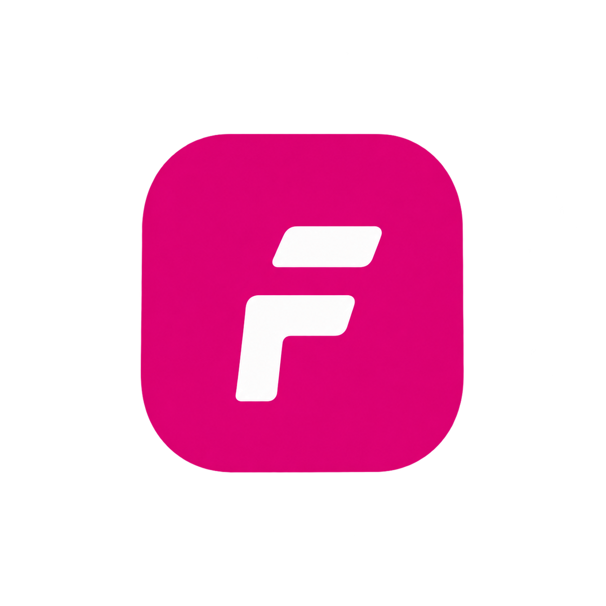
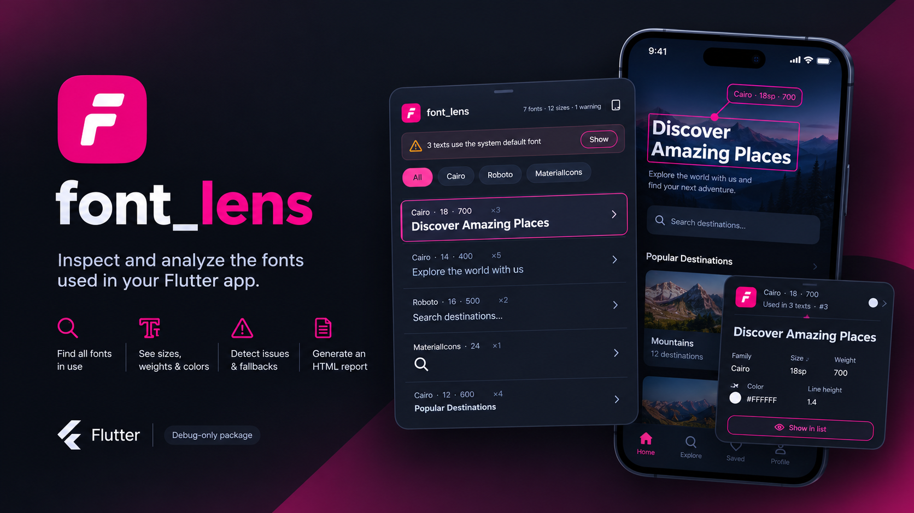

<p align="center">
  
</p>

<h1 align="center">Font Lens</h1>

<p align="center">
  <b>The Live In-App Typography Inspector for Flutter</b><br>
  <i>Inspect what your screen actually renders in real-time — not just what your theme defines.</i>
</p>

<p align="center">
  <a href="https://pub.dev/packages/font_lens"></a>
  <a href="https://pub.dev/packages/font_lens/score"></a>
  <a href="https://pub.dev/packages/font_lens"></a>
  <a href="https://github.com/AhmedMonatah/Flutter_Lens/actions"></a>
  <a href="https://github.com/AhmedMonatah/Flutter_Lens/blob/main/LICENSE"></a>
</p>

---

<p align="center">
  
</p>

---

## 💡 Why Font Lens?

Flutter themes describe what styles *should* be available, but they don't tell you what is **actually being rendered on screen right now**. Third-party packages, hardcoded `TextStyle`s, nested widgets, and missing fallback configurations often cause subtle typography bugs that slip past code review.

| Tool | What it shows | Real-time? | Arabic Fallback Check? |
|:---|:---|:---:|:---:|
| `font_preview` | Only fonts you manually hardcode | ❌ No | ❌ No |
| `theme_inspector` | Only what `ThemeData` *defines* | ❌ No | ❌ No |
| **⚡ Font Lens** | **Exact styles rendered in the active Element Tree** | **✅ Live** | **✅ Automated** |

**Font Lens** solves this by scanning your live widget tree in debug mode, grouping typography styles, unmasking OS defaults (`fontFamily == null`), highlighting rendered text bounding boxes, and warning you when design rules or Arabic fallbacks are violated.

---

## ✨ Key Features

- 🔍 **Live Element-Tree Scanner:** Automatically traverses the active Flutter render tree to detect `Text`, `RichText`, `Text.rich`, and `TextField` widgets while excluding offstage elements.
- 🎯 **Interactive Pick Mode:** Tap anywhere on your screen to isolate and inspect the exact font family, resolved size, weight, line height, color, and widget hierarchy.
- 🎨 **Visual Highlight Overlays:** Highlights all active text widgets on screen with non-intrusive bounding boxes to visualize typography density.
- 🧠 **Smart System Default Unmasking:** `fontFamily: null` is clearly explained as **"System default (Roboto on Android / SF Pro on iOS)"** instead of leaving developers guessing.
- ⚠️ **Design Health & Arabic Fallback Warnings:**
  - **Missing Arabic Fallbacks:** Flags Arabic text rendered without `fontFamilyFallback` to prevent OS font mismatch or missing glyphs.
  - **Too Many Font Families:** Warns if more than 3 distinct font families appear on a single screen.
  - **Too Many Font Sizes:** Flags screens using more than 8 distinct font sizes.
  - **Faux-Bold Detection:** Catches weights $\ge$ 600 where no true bold variant is loaded.
- 🛡️ **Zero Release Overhead:** Uses `kDebugMode` by default. In release builds, `FontLens` compiles down to a direct pass-through `child` with 0% runtime overhead.
- 🌐 **Bilingual (English & Arabic RTL):** Built-in support for Arabic localization with native RTL layout.
- 🔒 **Privacy-First Text Redaction:** Optional `redactText: true` masks sensitive customer text (PII, passwords) with placeholder dots (`••••`) in inspector views and audits.
- 📋 **One-Click JSON Export:** Easily copy the complete typography audit of the current screen to your clipboard for design QA or bug reports.

---

## 📦 Installation

Add `font_lens` to your `pubspec.yaml`:

```yaml
dev_dependencies:
  font_lens: ^0.1.0
```

*(Recommended under `dev_dependencies` since it's a debug inspector, or under `dependencies` if you plan to configure runtime controllers).*

---

## 🚀 Quick Start (Only 3 Lines)

Wrap your app inside `MaterialApp.builder` (or `WidgetsApp.builder`):

```dart
import 'package:flutter/foundation.dart';
import 'package:flutter/material.dart';
import 'package:font_lens/font_lens.dart';

void main() => runApp(const MyApp());

class MyApp extends StatelessWidget {
  const MyApp({super.key});

  @override
  Widget build(BuildContext context) {
    return MaterialApp(
      title: 'My App',
      builder: (context, child) => FontLens(
        enabled: kDebugMode, // Completely disabled in release builds
        child: child!,
      ),
      home: const HomeScreen(),
    );
  }
}
```

A floating **Font Lens** button will appear in debug mode. Tap it to open the inspector panel!

---

## 🎯 How It Works

### 1. The Inspector Sheet
- **Collapsed Bar:** Shows a quick summary badge of distinct fonts, distinct sizes, and active warnings.
- **Half & Full Snap:** Expands into a categorized breakdown grouped by **Font Family**, **Font Size**, or **Active Warnings**.
- **Filter Chips:** Filter the view by a specific font family or isolate warning items.

### 2. Interactive Pick Mode
1. Tap the **Pick** icon in the header.
2. Tap any text element directly on your screen.
3. A detailed card pops up displaying:
   - Full rendered string snippet
   - Font family (and resolved OS asset)
   - Font size, weight, letter spacing, line height
   - Exact text color with hex code & opacity
   - Widget location in the hierarchy

### 3. Highlight Layer
Toggle **Highlight** to draw bounding boxes around every text element on screen. Easily check text alignment, bounding margins, and detect clipped or overflowed text boxes.

---

## 🖌️ Handling `CustomPainter`

Text painted directly via `TextPainter` inside a `CustomPainter` bypasses the Flutter widget tree. You can opt-in to track custom-painted text using `FontLens.track`:

```dart
class BadgePainter extends CustomPainter {
  @override
  void paint(Canvas canvas, Size size) {
    final tp = FontLens.track(
      TextPainter(
        text: const TextSpan(
          text: 'PRO',
          style: TextStyle(fontFamily: 'Cairo', fontSize: 14, fontWeight: FontWeight.bold),
        ),
        textDirection: TextDirection.ltr,
      )..layout(),
    );

    tp.paint(canvas, Offset.zero);
  }

  @override
  bool shouldRepaint(covariant CustomPainter oldDelegate) => false;
}
```

---

## ⚙️ Configuration Options

Customize `FontLens` to match your development workflow:

```dart
FontLens(
  enabled: kDebugMode,                  // Toggle inspector on/off
  themeMode: FontLensThemeMode.device,  // .device, .light, or .dark
  locale: const Locale('ar'),           // Force Arabic RTL or English UI (or null for system)
  redactText: false,                    // Set to true to mask text content for privacy
  child: child!,
)
```

| Parameter | Type | Default | Description |
|:---|:---|:---|:---|
| `enabled` | `bool` | `kDebugMode` | Activates inspector in debug and passes child directly in release. |
| `themeMode` | `FontLensThemeMode` | `device` | Controls inspector sheet brightness (`light`, `dark`, or `device`). |
| `locale` | `Locale?` | `null` | Language override (`Locale('en')` or `Locale('ar')`). Follows device if null. |
| `redactText` | `bool` | `false` | When true, obscures text content with `••••` to prevent exposing PII. |
| `controller` | `FontLensController?` | `null` | Optional external controller to programmatically open/close the panel. |

---

## ⚠️ Warning Rules Reference

Font Lens comes with built-in design guardrails:

| Warning | Trigger Condition | Why it matters |
|:---|:---|:---|
| **Arabic without Fallback** | Arabic characters found with no `fontFamilyFallback` | Avoids ugly system fallback mixing, missing glyphs, or broken letter shaping. |
| **Too Many Font Families** | $> 3$ distinct font families on one screen | Inconsistent branding and design clutter. |
| **Too Many Font Sizes** | $> 8$ distinct font sizes on one screen | Broken typographic hierarchy and visual fatigue. |
| **Possible Faux-Bold** | Font weight $\ge 600$ where only one weight is available | Browser/OS synthesizes synthetic bolding which causes blurry rendering. |

---

## 🧪 Testing & Quality Assurance

Font Lens maintains high test coverage:

```bash
# Analyze code
dart analyze

# Run unit and widget tests
flutter test

# Verify formatting
dart format --set-exit-if-changed .
```

---

## 🤝 Contributing

Contributions, feature requests, and bug reports are welcome! Feel free to check the [issues page](https://github.com/AhmedMonatah/Flutter_Lens/issues).

---

## 📄 License

This project is licensed under the MIT License — see the [LICENSE](LICENSE) file for details.
